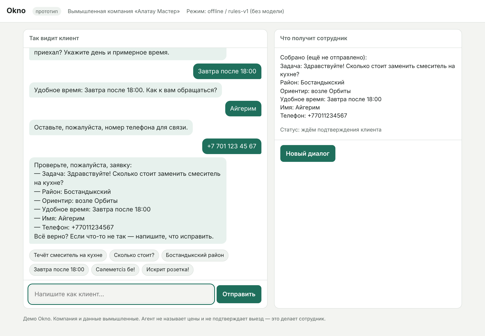

# Демо Okno — как запустить и показать

Сценарий: [scenario.md](scenario.md). Запись демо-диалогов: [demo-transcript.md](demo-transcript.md).
Прогон 20 тестовых диалогов: [eval-report.md](eval-report.md). Код: [okno/](../okno/README.md).



## Запуск на своём компьютере

Нужен Python 3.10 или новее. Из папки репозитория:

```bash
python3 -m okno.web --port 8080
```

Откройте http://127.0.0.1:8080. Чтобы показать на телефоне клиента в той же Wi-Fi-сети:

```bash
python3 -m okno.web --host 0.0.0.0 --port 8080
```

и откройте `http://<IP вашего ноутбука>:8080` на телефоне.

## Три режима

| Режим | Как включить | Что это |
|---|---|---|
| Офлайн | без ключей (по умолчанию, если ключей нет) | правила и шаблоны, без модели; в шапке написано «без модели». Хорош для первой встречи без интернета |
| Claude | `pip install anthropic`, затем `export ANTHROPIC_API_KEY=...` | настоящая модель; по умолчанию `claude-opus-5-5`, другая — `export OKNO_MODEL=claude-haiku-5-5` |
| Gemini | `export GEMINI_API_KEY=...` (ключ из Google AI Studio) | настоящая модель через официальный OpenAI-совместимый эндпоинт Google |

В облачной сессии ключей нет (решение D-008 в журнале), поэтому всё проверено в офлайн-режиме и на записанных
ответах модели. **Первое, что стоит сделать у себя:** прогнать тестовые диалоги на реальной модели.

```bash
python3 -m okno.evals.run --provider anthropic --model claude-haiku-5-5 --out product/eval-haiku.md
```

```bash
python3 -m okno.evals.run --provider anthropic --model claude-opus-5-5 --out product/eval-opus.md
```

Правило выбора модели для пилотов — самая дешёвая модель, которая проходит не меньше 90 % диалогов (D-012).

## Заявки сотрудникам

Каждая переданная заявка пишется в `data/leads.jsonl`. Чтобы карточка приходила в Telegram-чат сотрудников:
создайте бота у @BotFather, добавьте его в чат и задайте `TELEGRAM_BOT_TOKEN` и `TELEGRAM_CHAT_ID`
(пример — в `.env.example`). Для CRM — `OKNO_WEBHOOK_URL`.

## Как показывать владельцу компании

Сценарий показа — [gtm/pilots/demo-script.md](../gtm/pilots/demo-script.md). Коротко: владелец пишет как клиент
в левую часть, а в правой видит карточку, которую получит его сотрудник. Обязательно покажите: вопрос о цене
(агент не называет цену) и аварию (агент сразу зовёт человека).
